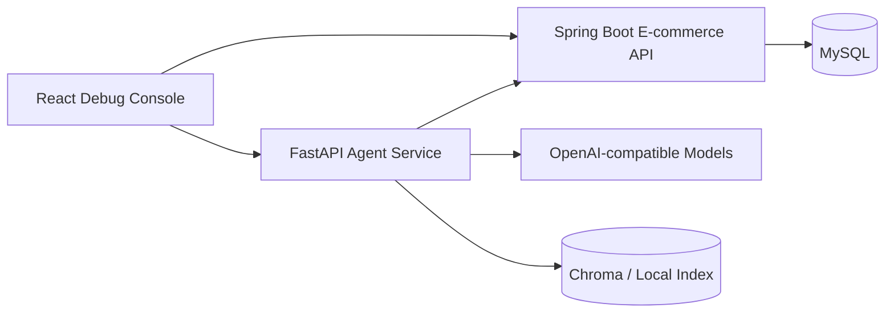

# Runtime Topology

## Agent service

`agent-service` is the orchestration boundary. It owns intent routing, tool execution, RAG, workflow state, trace, evaluation, feedback, and cost summaries.

## Business backend

`ecommerce-backend` is the source of order, logistics, product, refund, membership, and approval facts. The Agent service must not guess these values from model knowledge.

## Frontend

`frontend` is a debugging console. It may display public trace events and controlled reasoning summaries, but it must not receive hidden chain-of-thought or raw sensitive business data.

## Trust boundaries

- Runtime identity comes from the trusted request context.
- Tool parameters are validated before execution.
- RAG and tool text are untrusted inputs and pass the source guard.
- High-risk actions stop at approval instead of executing real money movement.