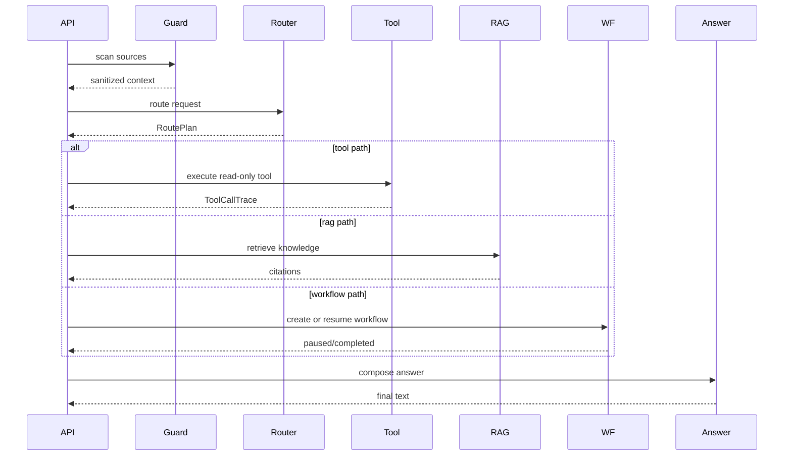

# Technical Plan: Agent Runtime Contract

| 字段 | 值 |
|---|---|
| Spec | `001-agent-runtime` |
| Status | implemented |
| Components | `api`, `agents`, `context`, `tools`, `rag`, `workflows`, `observability` |
| State | SessionStore、TraceStore、CheckpointStore 当前为进程内 |
| Rollback | 回退 Agent 服务；业务后端无需同步回滚 |

## 1. 请求处理伪代码

```python
def chat(request: ChatRequest) -> ChatResponse:
    context = build_runtime_context(request)
    source_report = inspect_request_sources(request)
    guard = deterministic_guard(request, context, source_report)
    if guard.blocked:
        return security_response(guard)

    route = router.plan_intent(request, context, safe_context)
    route = enforce_policy(route, context)
    execution = execute_route(route, context)

    if execution.kind == "clarification":
        return clarification_response(execution)
    if execution.kind == "workflow":
        return workflow_response(execution)
    if execution.kind == "degradation":
        return degradation_response(execution)

    answer = answer_client.compose_answer(
        request=request,
        context=context,
        execution=execution,
    )
    return build_chat_response(answer, execution, context)
```

## 2. 组件交互



## 3. 状态所有权

| 状态 | Owner | 生命周期 |
|---|---|---|
| Runtime Context | request | 单次请求 |
| Session State | session store | 会话 |
| Trace | TraceStore | 会话 |
| Checkpoint | Workflow | 暂停到恢复 |
| Cost | session state | 单次请求 |

## 4. 配置

- `.env`：Provider、Base URL、服务 Token、离线开关；
- `agent_capabilities.json`：前端能力声明；
- `cases.yml`：固定回归 case；
- `prompts/`：Prompt Registry。

## 5. 并发与线程

- FastAPI 请求线程只负责协议和依赖注入；
- 模型调用和工具调用不共享 Session；
- TraceStore 采用锁保护；
- SessionStore 当前为进程内对象；
- Workflow resume 需要幂等锁或唯一约束。

## 6. 测试与回滚

- Schema 测试；
- RoutePlan 约束测试；
- 跨账号订单测试；
- Tool/RAG/Workflow/Security case；
- 灰度时先回退 Agent 服务，再检查持久化状态。