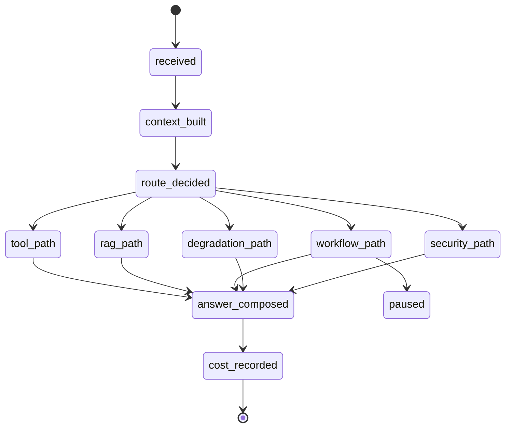

# Feature Specification: Agent Runtime Contract

| 字段 | 值 |
|---|---|
| Spec ID | `001-agent-runtime` |
| Status | implemented |
| Version | 2.0.0 |
| Owner | Agent Service |
| Scope | `/chat` 主运行时、路由、上下文、响应和 Trace |
| Related | `specs/002-tool-rag`, `specs/003-hitl-workflow`, `specs/004-safety-eval` |
| Evidence | `agent-service/api/schemas.py`, `agent-service/agents/customer_service_agent.py`, `agent-service/cases.yml`, `tests/` |

## 1. 背景

Ecom-ai 的一次请求同时可能涉及：

- 普通聊天；
- 实时订单和物流查询；
- 政策、活动和 FAQ 检索；
- 退款和退货工作流；
- 服务降级；
- Prompt 注入攻击。

如果把这些逻辑都交给模型自由决策，会产生四类风险：

1. 身份和订单归属被用户文本篡改；
2. 模型调用未授权工具；
3. 高风险售后流程被绕过；
4. 最终答案无法解释或无法回归。

Agent Runtime 的职责是把不可控的模型行为约束为可验证的系统状态转换。

## 2. 目标

- 将调用方提供的可信身份绑定到本轮上下文。
- 将模型路由约束在 Intent、Tool 和 Knowledge Domain 白名单内。
- 每轮请求只选择一个主执行路径，避免路径相互污染。
- 返回结构化回答、引用、工具、澄清、工作流状态和公开 Trace。
- 保证失败时可降级、可解释、可回归。
- 禁止 hidden chain-of-thought 和系统 Prompt 泄露。

## 3. 非目标

- 不实现多实例共享状态。
- 不执行真实资金动作。
- 不允许 Runtime 直接访问 Java 数据库。
- 不由 Runtime 承担 RAG 质量评估和业务审批的全部职责。

## 4. 角色与边界

| 角色 | 可提供 | 不可提供 |
|---|---|---|
| 调试前端 | session、Runtime Context、用户消息、审批结果 | 修改工具白名单、绕过 Guard |
| Agent Runtime | 路由、工具、RAG、Workflow、Trace、回答 | 真实资金动作、任意 SQL |
| E-commerce Backend | 订单、物流、商品、退款、审批事实 | Prompt 和模型编排 |
| Reviewer | 审批、拒绝、补充信息 | 修改冻结快照 |

## 5. 功能需求

### 5.1 输入与身份

| ID | 优先级 | 需求 | 验证 |
|---|---|---|---|
| R-RUNTIME-01 | P0 | `session_id`、`runtime_user_id`、`user_message` 必填。 | Schema test |
| R-RUNTIME-02 | P0 | 用户身份、会员等级和风险等级只来自 Runtime Context。 | `test_runtime_context.py` |
| R-RUNTIME-03 | P0 | `runtime_user_id`、`risk_level` 不得进入模型可见上下文。 | context projection test |
| R-RUNTIME-04 | P1 | 历史消息只接受 user / assistant 角色。 | Schema validation |

### 5.2 路由

| ID | 优先级 | 需求 | 验证 |
|---|---|---|---|
| R-ROUTE-01 | P0 | 路由输出必须是 `RoutePlan`，不允许返回自由 JSON。 | Pydantic contract |
| R-ROUTE-02 | P0 | Intent 必须属于固定枚举。 | route cases |
| R-ROUTE-03 | P0 | 工具必须经过白名单二次过滤。 | policy constraint test |
| R-ROUTE-04 | P0 | 高风险退款、退货、安全意图不得绕过确定性 Guard。 | HITL/security cases |
| R-ROUTE-05 | P1 | 模型不可用时使用 deterministic fallback。 | fallback test |
| R-ROUTE-06 | P1 | 缺少订单号或多候选订单时返回 clarification。 | clarification case |

### 5.3 执行

| ID | 优先级 | 需求 | 验证 |
|---|---|---|---|
| R-EXEC-01 | P0 | 每轮只允许一个主路径：tool / rag / workflow / degradation / security。 | route trace assertions |
| R-EXEC-02 | P0 | 所有工具调用前执行 Runtime 归属和参数校验。 | cross-account case |
| R-EXEC-03 | P0 | 最终回答只能使用受控事实、citation、workflow state 和公开摘要。 | answer contract |
| R-EXEC-04 | P1 | Tool 和 RAG 失败时必须有明确回退策略。 | degradation case |
| R-EXEC-05 | P1 | Workflow 暂停必须返回 `paused`、`workflow_id` 和 `resume_token`。 | HITL case |

### 5.4 输出与可观测性

| ID | 优先级 | 需求 | 验证 |
|---|---|---|---|
| R-OUT-01 | P0 | 返回 `answer`、`citations`、`tool_calls`、`session_state`。 | response schema |
| R-OUT-02 | P0 | 公开 Trace 只能包含 route / tool / rag / workflow / hook / cost / security。 | Trace schema |
| R-OUT-03 | P0 | 不返回 hidden CoT、系统 Prompt 和原始攻击文本。 | injection case |
| R-OUT-04 | P1 | `session_state.route` 必须表达 intent、risk、tools、RAG 和 workflow。 | eval assertions |

## 6. 输入契约

```python
class ChatRequest(BaseModel):
    session_id: str
    runtime_user_id: str
    runtime_nickname: str | None = None
    runtime_member_level: str | None = None
    runtime_risk_level: str | None = None
    user_message: str
    reasoning_view: Literal["default", "off", "summary", "teaching"] = "default"
    debug: bool = True
    runtime_context: dict[str, Any] | None = None
    history_messages: list[HistoryMessage] = []
```

校验规则：

1. `session_id` 不能为空。
2. `runtime_user_id` 不能为空。
3. `user_message` 不能为空。
4. `history_messages` 只允许 `user` / `assistant`。
5. `runtime_context` 中的订单必须经过 Runtime 归属校验。

## 7. 输出契约

```python
class ChatResponse(BaseModel):
    session_id: str
    answer: str
    citations: list[Citation]
    tool_calls: list[ToolCallTrace]
    clarification: ClarificationRequest | None
    reasoning_summary: list[str]
    reasoning_content: str | None
    session_state: dict[str, Any]
```

字段语义：

| 字段 | 说明 |
|---|---|
| `answer` | 面向用户的客服话术 |
| `citations` | RAG 回答来源，Tool 路径通常为空 |
| `tool_calls` | 本轮工具调用及结果摘要 |
| `clarification` | 缺参或多候选时的结构化追问 |
| `reasoning_summary` | 可公开的决策摘要 |
| `reasoning_content` | 默认不返回 |
| `session_state` | route、tool、rag、workflow、trace、cost |

## 8. 执行状态机



`paused` 是合法终止状态；恢复通过 `/chat/resume` 进入独立状态机。

## 9. 失败语义

| 错误 | 分类 | 对外行为 |
|---|---|---|
| Schema 校验失败 | client_error | 返回 422 |
| Runtime 无订单 | not_found | 说明无可访问订单 |
| 订单跨用户 | security | 阻断并记录安全事件 |
| Tool timeout | degradation | 降级转人工 |
| RAG 无命中 | low_confidence | 说明无依据或转人工 |
| 模型路由异常 | fallback | 走确定性路由 |
| Workflow 状态漂移 | blocked | 不恢复，要求重新核验 |
| Prompt 注入 | security_blocked | 不泄露受保护内容 |

## 10. 安全与隐私

- Runtime 身份不进入模型。
- Tool / RAG / History 文本均视为不可信输入。
- 公开 Trace 不保存 hidden CoT、系统 Prompt、攻击原文和 PII。
- 高风险动作必须经过 Workflow 和人工审批。
- 工具白名单不可由模型动态扩展。

## 11. 验收标准

- AC-01：Schema 必填字段缺失时请求被拒绝。
- AC-02：跨账号订单无法被工具读取。
- AC-03：物流 case 只走 Tool，不调用 RAG。
- AC-04：活动规则 case 返回 citation。
- AC-05：未发货退款停在 `paused`。
- AC-06：Prompt 注入不返回系统 Prompt。
- AC-07：13 条固定 case 全部通过。
- AC-08：Trace 中没有 hidden CoT 字段。

## 12. 需求追踪

| 需求 | 计划 | 任务 | 测试 |
|---|---|---|---|
| R-RUNTIME-01 | Plan §2 | T-RUNTIME-01 | Schema test |
| R-RUNTIME-02 | Plan §3 | T-RUNTIME-02 | test_runtime_context |
| R-ROUTE-01 | Plan §4 | T-ROUTE-01 | RoutePlan contract |
| R-ROUTE-03 | Plan §4 | T-ROUTE-02 | policy constraint |
| R-EXEC-01 | Plan §5 | T-EXEC-01 | route trace |
| R-EXEC-02 | Plan §6 | T-EXEC-02 | cross-account |
| R-OUT-01 | Plan §7 | T-OUT-01 | response schema |
| R-OUT-02 | Plan §8 | T-OUT-02 | trace schema |