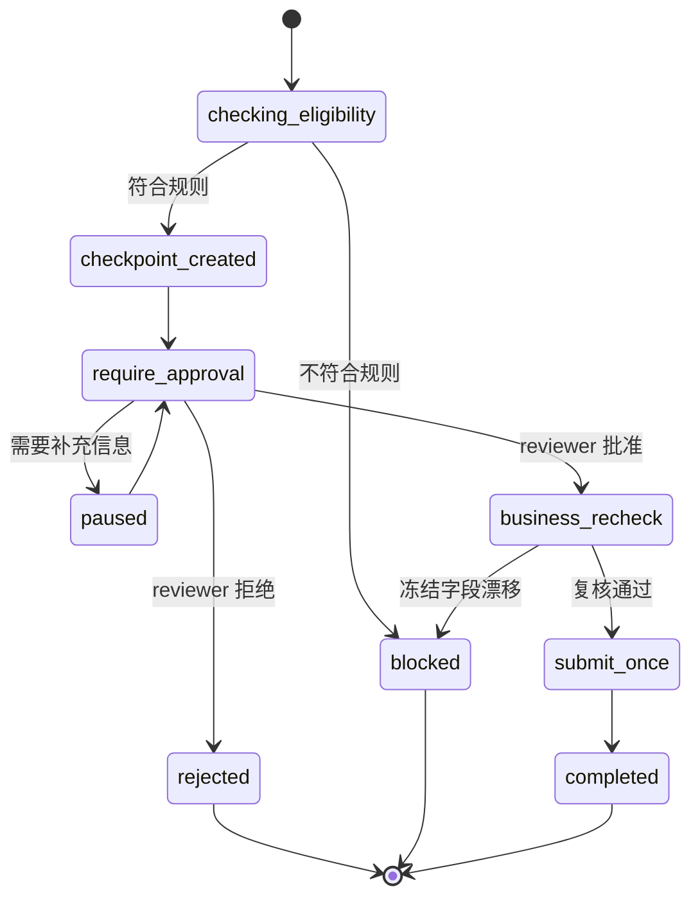

# Feature Specification: Refund and Return HITL

| 字段 | 值 |
|---|---|
| Spec ID | `003-hitl-workflow` |
| Status | implemented |
| Version | 2.0.0 |
| Owner | After-sale Workflow |
| Engine | LangGraph StateGraph |
| Related | `specs/001-agent-runtime`, `specs/004-safety-eval` |
| Evidence | `workflows/after_sale_graph.py`, `workflows/resume.py`, `cases.yml` |

## 1. 背景

退款和退货会影响订单状态、用户权益和潜在资金动作。Agent 可以：

- 读取订单事实；
- 判断资格；
- 收集审批信息；
- 暂停流程；
- 恢复流程。

Agent 不可以：

- 直接执行真实退款；
- 修改余额；
- 绕过审批；
- 在冻结字段漂移时继续恢复。

## 2. 目标

- 把退款和退货建模为显式状态机。
- 在 `require_approval` 暂停。
- 通过 `resume_token` 安全恢复。
- 使用冻结字段检测业务漂移。
- 保证审批幂等。
- 所有高风险边界可审计。

## 3. 工作流范围

### Refund Approval Workflow

适用：未发货退款。

### Received Return Workflow

适用：已签收后的七天无理由退货。

不在范围：

- 真实资金退款；
- 人工客服工单系统；
- 复杂多级审批；
- 跨订单合并退款。

## 4. 功能需求

| ID | 优先级 | 需求 | 验证 |
|---|---|---|---|
| R-HITL-01 | P0 | 未发货退款必须进入 workflow。 | unshipped-refund-hitl |
| R-HITL-02 | P0 | 已发货退款必须在 workflow 前阻止。 | shipped-refund-blocked |
| R-HITL-03 | P0 | 签收后退货必须验证签收时间和商品条件。 | received-return |
| R-HITL-04 | P0 | 暂停响应必须包含 workflow_id、pending_action、resume_token。 | response schema |
| R-HITL-05 | P0 | Resume 必须校验 workflow_id 和 token。 | invalid-token case |
| R-HITL-06 | P0 | Resume 必须重新读取业务事实并比较冻结字段。 | drift tests |
| R-HITL-07 | P0 | 审批必须幂等。 | approved-idempotent |
| R-HITL-08 | P1 | 拒绝和 needs_more_info 必须返回可读原因。 | resume cases |
| R-HITL-09 | P0 | 不执行真实资金动作。 | forbidden text + code review |
| R-HITL-10 | P1 | 所有审批必须记录 reviewer_id 和 reviewer_role。 | trace assertions |

## 5. 状态机



## 6. Checkpoint 契约

```json
{
  "workflow_id": "refund-SO...-xxxx",
  "workflow_type": "refund_approval",
  "session_id": "session-U1001-xxxx",
  "order_id": "SO20260601090000008-a1000008",
  "runtime_user_id": "U1001",
  "frozen_fields": {
    "fulfillment_status": "PENDING_SHIPMENT",
    "payment_status": "PAID",
    "amount": "799.00",
    "signed_at": null
  },
  "resume_token": "rt-xxxx",
  "idempotency_key": "idem-xxxx",
  "pending_action": "require_approval"
}
```

## 7. Resume 请求

```json
{
  "session_id": "session-U1001-xxxx",
  "workflow_id": "refund-SO...-xxxx",
  "resume_token": "rt-xxxx",
  "reviewer_id": "reviewer-001",
  "reviewer_role": "after_sale_reviewer",
  "decision": "approved",
  "reviewer_note": "已核验订单和退款资格"
}
```

决策枚举：

- `approved`
- `rejected`
- `needs_more_info`

## 8. 冻结字段复核

恢复时必须重新读取订单，并检查：

| 字段 | 漂移处理 |
|---|---|
| order_id | blocked |
| runtime_user_id | blocked |
| fulfillment_status | blocked |
| payment_status | blocked |
| amount | blocked |
| signed_at | blocked |

不允许只比较 workflow_id 后直接提交。

## 9. 幂等

推荐键：

```text
sha256(workflow_id + reviewer_id + decision + frozen_fields_hash)
```

重复请求：

- 已存在相同键：返回第一次结果；
- 请求体关键字段不同：返回冲突或重新审批；
- 已 completed：返回 completed 状态，不重复提交。

## 10. 失败语义

| 场景 | 行为 |
|---|---|
| checkpoint 不存在 | blocked |
| token 不匹配 | blocked |
| 订单字段漂移 | blocked |
| 上游接口 timeout | paused 或 transfer_to_human |
| 审批重复提交 | 返回首次结果 |
| 权限不匹配 | blocked + audit event |
| 已发货退款 | 在 Workflow 前阻止 |

## 11. 验收标准

- AC-01：未发货退款停在 require_approval。
- AC-02：已发货退款被规则阻止。
- AC-03：签收后退货符合窗口时进入 workflow。
- AC-04：无效 token 被阻断。
- AC-05：缺少 checkpoint 被阻断。
- AC-06：批准后重复恢复保持幂等。
- AC-07：任何响应不声称真实退款完成。
- AC-08：Trace 包含审批事件和 reviewer 信息。

## 12. 需求追踪

| 需求 | 计划 | 任务 | 测试 |
|---|---|---|---|
| R-HITL-01 | §2 | T-HITL-01 | unshipped-refund |
| R-HITL-02 | §3 | T-HITL-02 | shipped-blocked |
| R-HITL-03 | §4 | T-HITL-03 | received-return |
| R-HITL-04 | §5 | T-HITL-04 | response schema |
| R-HITL-05 | §6 | T-HITL-05 | invalid-token |
| R-HITL-06 | §7 | T-HITL-06 | drift tests |
| R-HITL-07 | §8 | T-HITL-07 | idempotent case |
| R-HITL-08 | §9 | T-HITL-08 | resume cases |
| R-HITL-09 | §10 | T-HITL-09 | forbidden text |